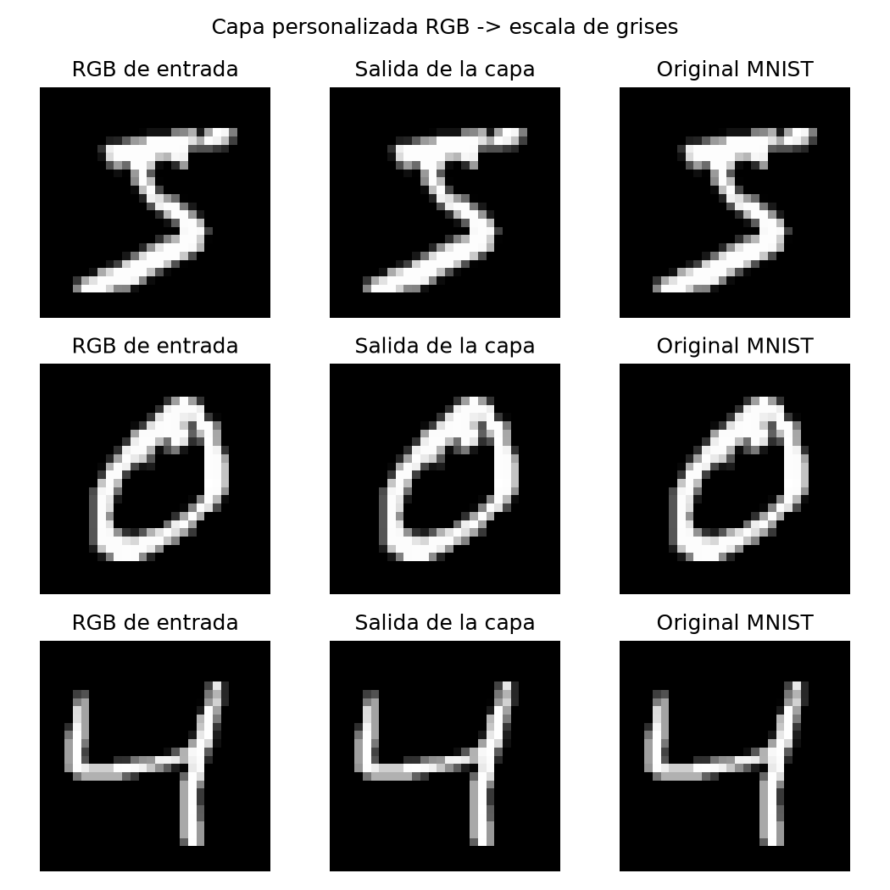
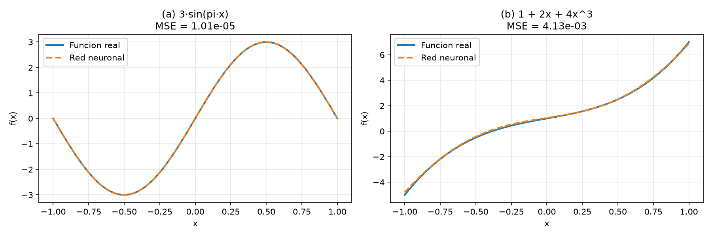
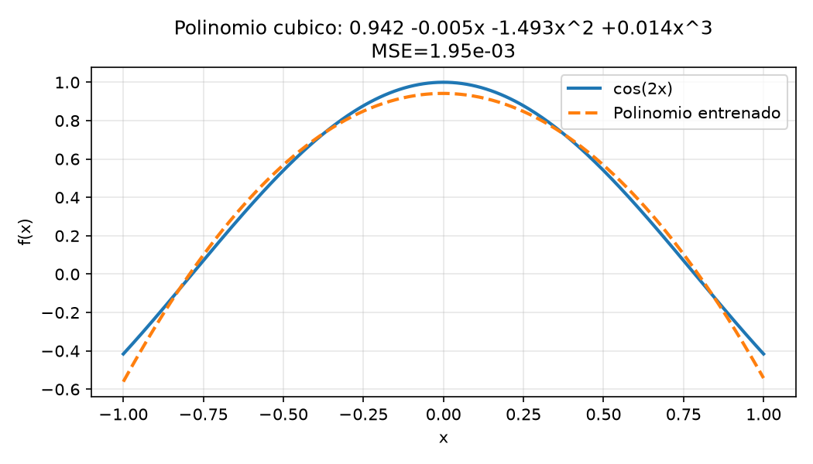
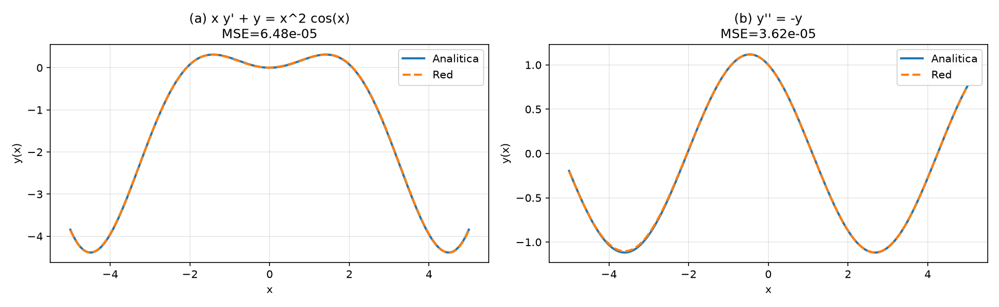

# Tarea 3: Funciones, modelos personalizados y ecuaciones diferenciales

Repositorio: https://github.com/ErickMeza0102/Tareaa3

Cada problema tiene su propio commit en la rama `main` de este repositorio
(además de un commit inicial con el código de los cuatro). No se usaron ramas
ni repositorios separados. Las gráficas están en `plots/`.

## Problema 1: capa RGB → escala de grises

Se implementó `RgbToGrayscale`, una capa personalizada de Keras que usa
`tf.image.rgb_to_grayscale` en su método `call`. No tiene pesos entrenables:
solo transforma la entrada. Para probarla se tomaron imágenes de MNIST, se
les repitió el canal de gris tres veces para simular RGB y se aplicó la capa.

```python
class RgbToGrayscale(layers.Layer):
    def call(self, inputs):
        return tf.image.rgb_to_grayscale(inputs)

    def compute_output_shape(self, input_shape):
        return input_shape[:-1] + (1,)
```

El error medio entre la salida y la imagen original fue **0.000013**, es decir,
la conversión es prácticamente exacta.



## Problema 2: aproximación de funciones en [-1,1]

Se entrenó una red densa `1 → 64 → 64 → 1` con activación `tanh` y Adam
(`lr=0.001`) durante 5000 épocas para cada función. La salida se estandarizó
(se le restó su media y se dividió entre su desviación estándar) antes de
entrenar; esto estabiliza mucho el ajuste del caso (b), cuyos valores van de
−5 a 7.

```python
modelo = models.Sequential([
    layers.Input(shape=(1,)),
    layers.Dense(64, activation="tanh"),
    layers.Dense(64, activation="tanh"),
    layers.Dense(1),
])
modelo.compile(optimizer=tf.keras.optimizers.Adam(0.001), loss="mse")
modelo.fit(x, (y - media) / desviacion, epochs=5000, batch_size=32)
```



- (a) `3·sin(πx)`: MSE = **1.008621e-05**.
- (b) `1 + 2x + 4x³`: MSE = **4.132926e-03**.

En ambos casos la curva de la red (línea punteada) sigue de cerca a la
función real (línea continua) en todo el intervalo; en (b) el error relativo
es menor al 1 %.

## Problema 3: capa polinómica entrenable

`PolinomioCubico` registra cuatro variables `a0, a1, a2, a3` en `build()` y
en `call()` devuelve `a0 + a1·x + a2·x² + a3·x³`. Se entrenó para ajustar
`cos(2x)` en `[-1,1]` con Adam (`lr=0.05`) durante 2500 épocas.

```python
class PolinomioCubico(layers.Layer):
    def build(self, input_shape):
        self.a0 = self.add_weight(shape=(), initializer="zeros", name="a0")
        self.a1 = self.add_weight(shape=(), initializer="zeros", name="a1")
        self.a2 = self.add_weight(shape=(), initializer="zeros", name="a2")
        self.a3 = self.add_weight(shape=(), initializer="zeros", name="a3")

    def call(self, x):
        return self.a0 + self.a1 * x + self.a2 * x**2 + self.a3 * x**3
```

Coeficientes aprendidos: `a0 = 0.94184`, `a1 = -0.00479`,
`a2 = -1.49312`, `a3 = 0.01412`. MSE = **1.949754e-03**.

El polinomio reproduce la forma de `cos(2x)`: el término cuadrático domina
la curvatura y los términos lineal y cúbico quedan casi en cero, como
corresponde a una función par.



## Problema 4: ecuaciones diferenciales

Se usó una red `1 → 32 → 32 → 1` con `tanh`. La pérdida combina el residuo
de la ecuación (calculado con diferenciación automática) y las condiciones
iniciales. El punto clave es que el residuo **y la pérdida se calculan dentro
del mismo `GradientTape`** para que los gradientes lleguen a los pesos.

```python
with tf.GradientTape(persistent=True) as outer:
    outer.watch(x)
    with tf.GradientTape(persistent=True) as inner:
        inner.watch(x)
        y = modelo(x, training=True)
    dy = inner.gradient(y, x)
    if orden == 2:
        d2y = outer.gradient(dy, x)

    y0 = modelo(x0, training=True)          # condición inicial
    residuo = x * dy + y - x**2 * tf.cos(x) if orden == 1 else d2y + y
    loss = tf.reduce_mean(residuo**2) + 10 * tf.reduce_mean(y0**2)

grads = outer.gradient(loss, modelo.trainable_variables)
optim.apply_gradients(zip(grads, modelo.trainable_variables))
```

### (a) `x·y' + y = x²·cos(x)`, `y(0)=0`

Solución analítica: como `(x·y)' = x²·cos(x)`,

`y = x·sin(x) + 2·cos(x) − 2·sin(x)/x`, con `y(0)=0` (se usa la serie de
Taylor `x²/3 − x⁴/10` cerca de cero para evitar la división por cero).

MSE numérico vs analítico: **6.483042e-05**.

### (b) `y'' = −y`, `y(0)=1`, `y'(0)=−0.5`

Solución analítica: `y = cos(x) − 0.5·sin(x)`.

MSE numérico vs analítico: **3.615455e-05**.



En las dos ecuaciones la solución de la red (línea punteada) se superpone a
la solución analítica (línea continua) en todo el intervalo `[-5,5]`, y las
condiciones iniciales se respetan.

## Conclusión

Las capas personalizadas funcionaron correctamente: la de grises no tiene
parámetros y la polinómica aprende sus cuatro coeficientes. La red aproximó
bien ambas funciones y las soluciones de las EDOs siguen a las soluciones
analíticas con error del orden de `1e-5`.
